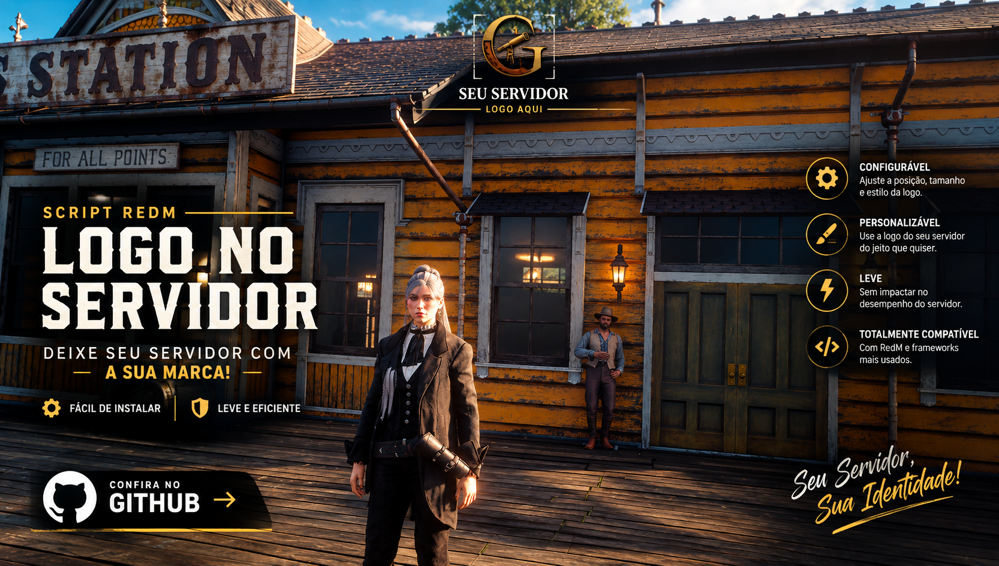

# logoServer



Exibe a logo do seu servidor na tela dos jogadores no **RedM**. Cada jogador pode mover e redimensionar a logo pelo próprio jogo, e a posição fica salva entre sessões.

## Recursos

- Logo fixa na tela via NUI, com leve transparência
- Modo de edição com o comando `/logo`: arraste para mover e use o scroll para redimensionar
- Posição e tamanho salvos por jogador (KVP do cliente), mantidos após reiniciar o servidor
- Esconde a logo automaticamente quando o menu de pausa está aberto
- Standalone: não depende de framework (funciona com VORP, RSG ou qualquer outro)

## Instalação

1. Baixe ou clone este repositório na pasta `resources` do seu servidor:
   ```
   resources/[DEV]/logoServer
   ```
2. Substitua `html/logo.png` pela logo do seu servidor (PNG com fundo transparente é o ideal).
3. Adicione ao `server.cfg`:
   ```
   ensure logoServer
   ```
4. Reinicie o servidor.

## Uso

| Ação | Como fazer |
| --- | --- |
| Entrar no modo de edição | `/logo` |
| Mover a logo | Clique e arraste |
| Redimensionar | Scroll do mouse (40 px a 600 px) |
| Salvar | `Enter` ou clique direito |

> **Importante:** salve com `Enter` ou clique direito. Se você sair digitando `/logo` de novo, as alterações não são gravadas e a logo volta à posição anterior no próximo login.

## Configuração

A posição padrão (para quem nunca editou) fica em [`html/index.html`](html/index.html):

```js
let state = { x: 50, y: 2, size: 140 }; // x/y em % da tela, size em px
```

- `x`: posição horizontal do centro da logo, em % da largura da tela
- `y`: distância do topo, em % da altura da tela
- `size`: largura da logo em pixels

A opacidade pode ser ajustada na regra CSS `#logo` (`opacity: .9`).

## Como o salvamento funciona

A posição é gravada com `SetResourceKvp` **no computador do jogador**, não no servidor. Então:

- Cada jogador tem a sua própria configuração.
- Reiniciar o servidor ou o resource **não** apaga o ajuste.
- O ajuste se perde se o resource for renomeado ou se o jogador limpar os dados do RedM.

## Estrutura

```
logoServer/
├── fxmanifest.lua
├── client.lua        # comando /logo, callbacks NUI, KVP e menu de pausa
└── html/
    ├── index.html    # interface (arrastar, redimensionar, salvar)
    ├── logo.png      # sua logo
    └── image.png     # banner do README (não é enviado aos jogadores)
```
